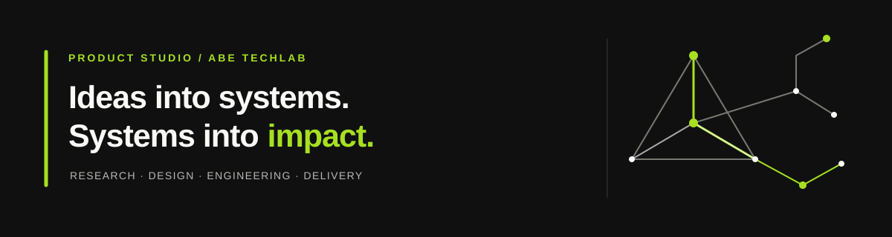

# ABE TechLab — Brand Library

The central library for ABE TechLab's visual identity assets, working color values, and practical usage guidance. Keep shared brand files organized here so company profiles, products, and communication materials can use a consistent starting point.

> **Asset status:** The logo SVGs in this repository are working vector approximations copied from the selected visual mark already used on the public GitHub profile. They are not the original editable master artwork, and exact geometry has not been independently verified against a source file. Treat them as current working assets—not as final, trademark-ready master artwork. The color values below reflect the existing SVG implementation and should be considered a working palette until formally approved.

## Quick asset index

| Use case | Asset | Notes |
| --- | --- | --- |
| Light backgrounds | [Light logo SVG](./brands/abe-techlab/source/abe-techlab-mark-light.svg) | Charcoal mark with lime accent; transparent canvas |
| Dark backgrounds | [Dark logo SVG](./brands/abe-techlab/source/abe-techlab-mark-dark.svg) | Off-white mark with lime accent; transparent canvas |
| Adaptive web and portfolio use | [Adaptive symbol SVG](./public/logos/abe-techlab-mark-adaptive.svg) | Standalone symbol that adapts to light/dark color schemes |
| Stacked brand lockup | [Stacked adaptive SVG](./public/logos/abe-techlab-lockup-stacked-adaptive.svg) | Symbol centered above the ABE TechLab wordmark |
| Horizontal brand lockup | [Horizontal adaptive SVG](./public/logos/abe-techlab-lockup-horizontal-adaptive.svg) | Symbol left of the ABE TechLab wordmark |
| Wordmark only | [Adaptive wordmark SVG](./public/logos/abe-techlab-wordmark-adaptive.svg) | ABE TechLab typography without the symbol |
| Stacked lockup PNGs | [Light PNG](./public/logos/abe-techlab-lockup-stacked-light-v1.png) · [Dark PNG](./public/logos/abe-techlab-lockup-stacked-dark-v1.png) | 1560 × 1050, transparent, fixed-color exports |
| Horizontal lockup PNGs | [Light PNG](./public/logos/abe-techlab-lockup-horizontal-light-v1.png) · [Dark PNG](./public/logos/abe-techlab-lockup-horizontal-dark-v1.png) | 2040 × 495, transparent, fixed-color exports |
| Wordmark PNGs | [Light PNG](./public/logos/abe-techlab-wordmark-light-v1.png) · [Dark PNG](./public/logos/abe-techlab-wordmark-dark-v1.png) | 1590 × 336, transparent, fixed-color exports |
| Agent standard | [AGENTS.md](./AGENTS.md) | Cross-product instructions for source control, precise exports, validation, and publishing |
| Product brand onboarding | [Onboarding guide](./docs/product-brand-onboarding.md) · [Manifest template](./templates/product-brand-manifest.json) | Establish a product-specific source of truth in the central brand library |
| ABE TechLab company brand | [Brand folder](./brands/abe-techlab/README.md) · [SVG source folder](./brands/abe-techlab/source/) | Parent-company symbol source SVGs and brand record |
| ABEmail product logo source | [Brand folder](./brands/abemail/README.md) · [SVG source folder](./brands/abemail/source/) | Original ABEmail logo variants uploaded; source review pending |
| TechTrack product logo source | [Brand folder](./brands/techtrack/README.md) · [SVG upload folder](./brands/techtrack/source/) | Original editable TechTrack logo SVGs; awaiting source upload |
| Reproducible PNG exporter | [export_logo_variants.py](./scripts/export_logo_variants.py) | Render light/dark PNGs from adaptive SVG masters without changing geometry |
| Email and static hosting | [Email-ready light PNG](./public/logos/abe-techlab-mark-light-v1.png) · [Email-ready dark PNG](./public/logos/abe-techlab-mark-dark-v1.png) | Transparent 320 × 255 PNG exports; intended to display at 160 px wide |
| Public asset index and color copier | [public/index.html](./public/index.html) | Logo previews, direct asset links, and copy-ready core HEX codes |
| Asset hosting guide | [Email logo assets](./docs/email-logo-assets.md) | Vercel static publishing, stable URLs, adaptive SVG, and email usage |
| GitHub profile | [Profile banner SVG](./assets/github/abe-techlab-profile-banner.svg) | 1200 × 320 banner for the organization profile |
| GitHub asset notes | [GitHub assets guide](./assets/github/README.md) | Current public copies and embedding guidance |
| Usage guidelines | [Brand guidelines](./docs/brand-guidelines.md) | Background choice, clear space, sizing, and handling |
| Color specifications | [Color palette](./docs/color-palette.md) | Core HEX/RGB values, copy-ready CSS, and banner support colors |
| Machine-readable tokens | [JSON color tokens](./tokens/brand-colors.json) · [CSS variables](./tokens/brand.css) | Reusable implementation values |

### GitHub profile banner



## Core brand colors

The three current core colors are:

| Color | HEX | RGB |
| --- | --- | --- |
| Lime green | `#A7E021` | `167, 224, 33` |
| Charcoal | `#111111` | `17, 17, 17` |
| Off-white | `#F9F9F6` | `249, 249, 246` |

Copy-ready CSS:

```css
:root {
  --abe-color-lime: #A7E021;
  --abe-color-charcoal: #111111;
  --abe-color-off-white: #F9F9F6;
}
```

The [public brand asset page](./public/index.html) includes swatches and buttons to copy each HEX code. See the [full color palette](./docs/color-palette.md) for usage notes and supporting banner colors.

## Logo usage at a glance

See [Logo lockups](./docs/logo-lockups.md) for the complete asset set, placement guidance, and format recommendations.

- Use the **light variant** on off-white and other light backgrounds.
- Use the **dark variant** on charcoal and other dark backgrounds.
- Use the **symbol-only mark** for app icons, avatars, favicons, and compact placements.
- Use the **stacked lockup** when the logo needs a centered or vertical composition.
- Use the **horizontal lockup** in website headers, footers, navigation, and document headers.
- Use the **wordmark-only** variant in text-led or narrow placements where the symbol would be redundant.
- The adaptive SVG variants switch their charcoal elements to off-white for dark color schemes and retain the lime accent. They are intended for modern browser contexts that support `prefers-color-scheme`.
- Use fixed-color transparent PNG exports for email clients and other platforms that sanitize SVG/CSS; retain SVGs as the vector working sources.
- Each new lockup has separate light and dark PNG exports rendered at 3× the SVG viewBox dimensions. Select the variant that matches the actual background; the PNGs do not automatically adapt to dark mode.
- The PNG exports are 320 × 255 pixels and are intended to be displayed at approximately 160 pixels wide.
- Keep lime as an accent and preserve the colors and proportions of the supplied assets.
- Leave clear space around the mark; don't stretch, rotate, crop, or add effects.
- Test contrast and legibility at the actual display size, especially for small icons.
- The SVGs and PNG exports are working representations of the current logo approximation, not independently verified master artwork or trademark-ready assets.
- When the artwork changes, publish a new versioned PNG filename (for example, `-v2.png`) and update the asset guide and downstream references. This avoids stale caches serving an older logo under a reused URL.

The public GitHub portfolio currently uses a `<picture>` element with separate light/dark SVG sources as a conservative fallback. The adaptive SVG is available for contexts that support it, but the existing two-source approach remains the most predictable option for the broadest range of Markdown renderers. See the [public profile README](https://github.com/ABE-TechLab/.github/blob/main/profile/README.md).

## Static asset hosting on Vercel

The `public/` directory is the deployment output for a small static Vercel project. The Branding repository can remain private; Vercel builds/deploys from the connected repository and serves files in `public/` at the deployment root.

Recommended project settings:

| Vercel setting | Value |
| --- | --- |
| Framework Preset | Other |
| Root Directory | `./` |
| Build Command | Disabled / empty |
| Output Directory | `public` |
| Install Command | Disabled / empty |

After the production deployment is ready, the image and SVG files will be available at:

- `https://<production-domain>/logos/abe-techlab-mark-adaptive.svg`
- `https://<production-domain>/logos/abe-techlab-mark-light-v1.png`
- `https://<production-domain>/logos/abe-techlab-mark-dark-v1.png`
- `https://<production-domain>/logos/abe-techlab-lockup-stacked-light-v1.png` and `...-dark-v1.png`
- `https://<production-domain>/logos/abe-techlab-lockup-horizontal-light-v1.png` and `...-dark-v1.png`
- `https://<production-domain>/logos/abe-techlab-wordmark-light-v1.png` and `...-dark-v1.png`

Replace `<production-domain>` with the production domain assigned to the Vercel project. Use the project's production domain or a custom domain—not a preview deployment URL, GitHub file-page URL, or tokenized download URL.

The root page (`/`) is a small index with logo previews, direct links, and copy-ready brand colors. The exact deployment URL is determined by the Vercel project and domain configuration; it is intentionally not guessed or hardcoded here. Ensure Vercel Deployment Protection is not enabled for these public assets, otherwise email recipients and anonymous image proxies may be unable to fetch them.

See [Email logo assets](./docs/email-logo-assets.md) for the HTML examples and ABEmail configuration notes.

## Repository structure

```text
.
├── README.md
├── AGENTS.md
├── assets/
│   └── github/
│       ├── README.md
│       └── abe-techlab-profile-banner.svg
├── brands/
│   ├── abe-techlab/
│   │   ├── brand.json
│   │   ├── README.md
│   │   └── source/
│   │       ├── README.md
│   │       ├── abe-techlab-mark-dark.svg
│   │       └── abe-techlab-mark-light.svg
│   ├── abemail/
│   │   ├── README.md
│   │   └── source/
│   └── techtrack/
│       ├── README.md
│       └── source/
├── docs/
│   ├── product-brand-onboarding.md
│   ├── logo-lockups.md
│   ├── brand-guidelines.md
│   ├── color-palette.md
│   └── email-logo-assets.md
├── scripts/
│   ├── export_logo_variants.py
│   └── requirements-brand-assets.txt
├── templates/
│   └── product-brand-manifest.json
├── public/
│   ├── index.html
│   └── logos/
│       ├── abe-techlab-mark-adaptive.svg
│       ├── abe-techlab-lockup-stacked-adaptive.svg
│       ├── abe-techlab-lockup-horizontal-adaptive.svg
│       ├── abe-techlab-wordmark-adaptive.svg
│       ├── abe-techlab-lockup-stacked-light-v1.png
│       ├── abe-techlab-lockup-stacked-dark-v1.png
│       ├── abe-techlab-lockup-horizontal-light-v1.png
│       ├── abe-techlab-lockup-horizontal-dark-v1.png
│       ├── abe-techlab-wordmark-light-v1.png
│       ├── abe-techlab-wordmark-dark-v1.png
│       ├── abe-techlab-mark-dark-v1.png
│       └── abe-techlab-mark-light-v1.png
└── tokens/
    ├── brand-colors.json
    └── brand.css
```

## Reuse the CSS tokens

Import or copy the tokens from [`tokens/brand.css`](./tokens/brand.css) into a compatible web project. If the values change after brand review, update the CSS, JSON, palette document, and any dependent assets in the same change.

```css
@import "./brand.css";

.brand-surface {
  background: var(--abe-color-charcoal);
  color: var(--abe-color-off-white);
}

.brand-accent {
  color: var(--abe-color-lime);
}
```

## Public and private asset locations

This repository is the **private working brand library**. Its `public/` directory is published by the separate Vercel static project; "public" here describes the deployment output, not the GitHub repository's visibility. The public GitHub organization profile also has its own copies in [`ABE-TechLab/.github`](https://github.com/ABE-TechLab/.github/tree/main/profile/assets). Keep those copies synchronized when the working assets change; don't link public README images directly to private files.

## Updating the brand library

1. Confirm the source and intended use of a proposed asset.
2. Preserve the previous file until the replacement has been reviewed.
3. Update the asset inventory, usage guidance, and token files when relevant.
4. Check light and dark backgrounds, contrast, and small-size legibility.
5. Copy approved public assets to `ABE-TechLab/.github` only when they are intended for public display.
6. Be clear about what is working draft versus formally approved.

No separate redistribution license is declared by this repository at present. Do not assume the assets are licensed for third-party redistribution.


## Brand operations for every ABE product

`AGENTS.md` is the central agent operating standard for all ABE TechLab and product brand work. Follow it before sourcing, designing, exporting, approving, or publishing logos and tokens. New product identities should be onboarded through the [product brand guide](./docs/product-brand-onboarding.md) and represented with the [manifest template](./templates/product-brand-manifest.json). The [PNG export script](./scripts/export_logo_variants.py) makes fixed-color light/dark PNG derivatives from the approved adaptive SVG masters; it does not redraw their geometry.
